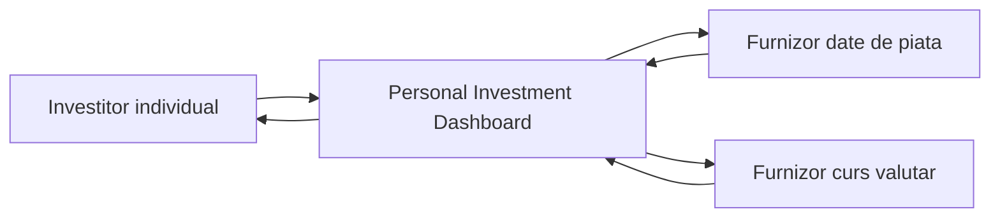
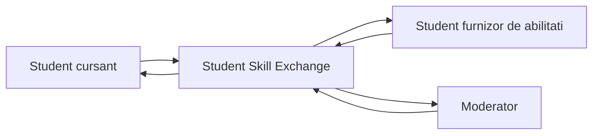

# Laboratorul 1 - Definirea produsului initial

**Student:** Pușca Sandu  
**Grupa:** CIB 241  
**Limba:** Română

Acest laborator documentează **Personal Investment Dashboard** (tema obligatorie) și **Student Skill Exchange** (proiect alternativ, supus acceptării profesorului).

**Dovezi de cercetare:** URL-urile sunt incluse în secțiunile de cercetare și referințe. Pentru a respecta regulile de prezentare, adaugă capturi de ecran autentice în `assets/` și referințe la ele, sau pregătește o demonstrație live. Acest fișier nu pretinde că au fost atașate capturi.

---

## Personal Investment Dashboard

Laboratorul 1 — Definirea produsului inițial

Personal Investment Dashboard

Solicitarea clientului: „Ajută-mă să îmi urmăresc investițiile.”

Scop: definirea unei prime versiuni utile, fără alegerea tehnologiilor sau proiectarea arhitecturii interne.

### 1. Cercetarea produselor

Întrebarea de cercetare: Cum ajută produsele existente utilizatorii să urmărească informațiile de piață și ce funcții sunt potrivite pentru prima versiune a Dashboard-ului?

| Produs | Utilizator probabil și obiectiv | Model reutilizabil |
| --- | --- | --- |
| Google Finance (date de piață) | Investitor individual care urmărește evoluția unor simboluri și indicii. | Căutarea instrumentelor, liste de urmărire, afișarea prețului și a evoluției în timp [1]. |
| TradingView (analiză și tranzacționare) | Investitor sau trader care analizează piețe și urmărește instrumente financiare. | Liste de urmărire, grafice și alerte; pentru V1 preluăm ideea de monitorizare, nu tranzacționarea [2]. |

Decizie bazată pe cercetare: V1 va permite introducerea manuală a deținerilor, urmărirea valorii estimate și observarea variației. Nu va executa ordine de cumpărare/vânzare și nu va include instrumente avansate de analiză tehnică. Acestea ar extinde produsul dincolo de cererea „follow my investments”.

Limită a dovezilor: paginile publice indică funcții promovate, nu confirmă implementarea lor internă sau calitatea datelor pentru fiecare piață.

### 2. Stakeholderi și actori

| Stakeholder | Motivație | Influență | Motiv |
| --- | --- | --- | --- |
| Investitor individual | Ridicată | Ridicată | Utilizatorul principal; nevoile și feedbackul său definesc produsul. |
| Proprietarul produsului | Ridicată | Ridicată | Decide prioritățile, bugetul și limitele V1. |
| Furnizorul datelor de piață | Ridicată | Ridicată | Are interes comercial și controlează disponibilitatea cotațiilor furnizate. |
| Furnizorul cursurilor valutare | Scăzută | Ridicată | Poate condiționa conversia valorilor prin acoperire și disponibilitate. |
| Autoritate de reglementare | Scăzută | Ridicată | Poate influența regulile de informare financiară, fără utilizare directă. |
| Familia investitorului | Scăzută | Scăzută | Poate fi afectată indirect de deciziile investitorului, dar nu folosește V1. |

#### Matrice motivație–influență

| Motivație | Influență scăzută | Influență ridicată |
| --- | --- | --- |
| Ridicată | — | Investitor; proprietarul produsului; furnizorul datelor de piață |
| Scăzută | Familia investitorului | Furnizorul cursurilor valutare; autoritate de reglementare |

Clasificările reprezintă ipoteze pentru proiect, care trebuie revizuite după consultarea stakeholderilor.

#### Clasificarea candidaților

| Candidat | Categorie | Interacțiune cu Dashboard-ul |
| --- | --- | --- |
| Investitor individual | Actor uman direct | Adaugă dețineri, consultă valori și variații. |
| Furnizor date de piață | Sistem extern direct | Furnizează prețuri și momentele de referință ale acestora. |
| Furnizor curs valutar | Sistem extern direct | Furnizează cursuri și momentele de referință. |
| Proprietar produs; autoritate; familie | Alți stakeholderi | Nu interacționează direct cu V1. |

### 3. Promisiunea produsului și delimitarea scopului

#### Product promise

Personal Investment Dashboard îi ajută pe investitorii individuali să urmărească deținerile introduse de ei și evoluția valorii lor estimate, astfel încât să înțeleagă mai ușor situația investițiilor fără să efectueze tranzacții.

#### Cinci obiective vizibile pentru utilizator

G1. Investitorul poate înregistra și actualiza instrumentele deținute, cantitățile și costul de achiziție.

G2. Investitorul poate vedea valoarea estimată a fiecărei dețineri pe baza celei mai recente cotații disponibile.

G3. Investitorul poate vedea valoarea totală estimată a portofoliului într-o monedă aleasă, când conversia este disponibilă.

G4. Investitorul poate identifica diferența estimată dintre valoarea actuală și costul introdus, fără a confunda această diferență cu un câștig realizat.

G5. Investitorul poate recunoaște clar cotațiile lipsă, vechi sau instrumentele nesuportate și poate evita concluzii bazate pe date prezentate fals ca actuale.

#### Trei non-obiective V1

N1. Nu se execută ordine de cumpărare sau vânzare și nu se transferă bani.

N2. Nu se oferă recomandări personalizate de investiții sau optimizare automată a portofoliului.

N3. Nu se sincronizează automat conturi de brokeraj și nu se calculează taxe sau obligații fiscale.

#### Constrângeri și ipoteze

Constrângeri: deținerile sunt introduse manual; V1 urmărește numai instrumentele pentru care există cotații identificabile; informațiile afișate sunt orientative, nu confirmări de tranzacție. Ipoteze de validat: sursele externe oferă cotații și cursuri cu marcaj temporal; utilizatorul cunoaște cantitatea și costul achiziției; există un identificator suficient pentru diferențierea instrumentelor.

### 4. Cerințe funcționale — User Stories și Definitions of Done

Metoda Three Cs: fiecare cerință are Card (poveste), Conversation (cazuri și limite) și Confirmation (verificări observabile).

#### DASH-1 — Înregistrarea deținerilor

Actor goal: Investitorul dorește să înregistreze ce instrumente deține și în ce cantitate.

User story: As an Investor, I want to record my holdings and purchase costs, so that I can follow the investments I own.

Conversation: Identificatorul instrumentului, cantitatea pozitivă, moneda și costul sunt necesare; instrumentele nesuportate nu sunt tratate ca evaluate.

Definitions of done:

O deținere validă apare cu instrumentul, cantitatea, moneda și costul introduse.

O deținere existentă poate fi corectată sau eliminată, iar totalurile reflectă schimbarea.

Datele incomplete ori cantitățile nevalide sunt respinse cu un motiv clar.

Instrumentul fără identificare validă nu primește automat o cotație inventată.

#### DASH-2 — Urmărirea valorii unei dețineri

Actor goal: Investitorul vrea să cunoască valoarea estimată și actualitatea prețului.

User story: As an Investor, I want to see the estimated value of each holding, so that I can understand its current market exposure.

Conversation: Valoarea estimată depinde de preț și cantitate; un preț vechi nu este prezentat drept curent.

Definitions of done:

Pentru un instrument suportat, se afișează valoarea estimată și moneda acesteia.

Se indică momentul de referință al cotației folosite.

Dacă prețul lipsește, valoarea este marcată indisponibilă, nu zero.

Dacă prețul este învechit, rezultatul este etichetat explicit ca bazat pe date vechi.

#### DASH-3 — Valoarea totală a portofoliului

Actor goal: Investitorul dorește o imagine agregată într-o monedă aleasă.

User story: As an Investor, I want to see my portfolio total in a chosen currency, so that I can understand its overall estimated size.

Conversation: Conversia se face numai când există un curs aplicabil; totalul incomplet trebuie diferențiat de totalul complet.

Definitions of done:

Când toate prețurile și cursurile sunt disponibile, se afișează totalul estimat în moneda selectată.

Valorile convertite indică moneda aleasă și data/ora cursului utilizat.

Dacă lipsește un curs sau o cotație, totalul este marcat incomplet și sunt indicate deținerile neincluse.

O monedă fără conversie disponibilă nu produce un total aparent complet.

#### DASH-4 — Diferența față de cost

Actor goal: Investitorul vrea să înțeleagă variația estimată a deținerilor.

User story: As an Investor, I want to compare estimated market value with recorded purchase cost, so that I can see unrealized gains or losses.

Conversation: Diferența estimată nu este profit realizat și nu include automat taxe ori comisioane.

Definitions of done:

Pentru date complete, se afișează diferența valorică și procentuală față de costul introdus.

Un rezultat negativ este prezentat ca pierdere estimată, nu ca valoare pozitivă.

Dacă lipsește costul sau o cotație utilizabilă, diferența este indisponibilă cu explicație.

Diferența este etichetată ca nerealizată și nu este prezentată drept recomandare financiară.

#### DASH-5 — Identificarea și căutarea instrumentelor

Actor goal: Investitorul trebuie să selecteze corect un instrument de investiție.

User story: As an Investor, I want to identify a supported investment instrument, so that I can track the correct asset.

Conversation: Simboluri similare pot reprezenta instrumente diferite; selecția trebuie să fie neambiguă.

Definitions of done:

Pentru un instrument recunoscut, sunt afișate suficiente detalii pentru a-l distinge (de exemplu nume, simbol, piață și monedă).

Dacă există mai multe rezultate similare, investitorul poate alege explicit instrumentul corect.

Dacă instrumentul nu este suportat sau nu este găsit, se afișează acest rezultat, fără substituire automată.

#### DASH-6 — Accesul la propriile dețineri

Actor goal: Investitorul dorește ca informațiile personale despre portofoliu să nu fie vizibile altor persoane.

User story: As an Investor, I want only my authorized account to access my holdings, so that my investment information remains private.

Conversation: Vizualizarea și modificarea deținerilor sunt permise numai utilizatorului autorizat.

Definitions of done:

Investitorul autorizat poate consulta și modifica propriile dețineri.

Un utilizator neautorizat nu poate vedea ori modifica deținerile altuia.

O solicitare fără drepturi primește un rezultat clar de acces refuzat, fără expunerea valorilor.

### 5. C4 — System Context

Diagrama prezintă sistemul ca o singură entitate, un actor uman direct și două sisteme externe. Nu include structura internă, aplicații, protocoale sau tehnologii.

#### 
#### Diagrama System Context (Mermaid)

Responsabilități și limite

| În responsabilitatea Dashboard-ului | În afara limitei Dashboard-ului |
| --- | --- |
| Păstrează deținerile introduse de utilizator și aplică restricțiile de acces. | Investitorul răspunde de corectitudinea cantităților și costurilor introduse. |
| Calculează și explică valorile estimate, diferențele și totalurile. | Furnizorul datelor de piață este sursa prețurilor și a momentului lor de referință. |
| Afișează conversii doar când există cursuri aplicabile. | Furnizorul cursurilor valutare este sursa cursului și a momentului lui de referință. |
| Marchează lipsa, vechimea și lipsa suportului, fără a fabrica valori. | Piețele și brokerii determină tranzacțiile reale; Dashboard-ul nu le execută. |

#### Dependențe externe și rezultate alternative

| Sistem extern | De ce este necesar / rezultat furnizat | Rezultat vizibil când apare o problemă |
| --- | --- | --- |
| Furnizor date de piață | Permite evaluarea deținerilor; furnizează cotație, monedă și moment de referință. | Lipsă: „Preț indisponibil”; vechi: „Cotație învechită”; instrument nesuportat: „Instrument nesuportat”. Valoarea nu este prezentată ca actuală. |
| Furnizor curs valutar | Permite totalul într-o monedă aleasă; furnizează cursul și momentul de referință. | Lipsă: „Conversie indisponibilă”; vechi: „Curs învechit”; pereche nesuportată: „Conversie nesuportată”. Totalul este marcat incomplet. |

Regulă de proprietate: furnizorii controlează datele-sursă; Dashboard-ul controlează interpretarea lor și mesajul sigur afișat utilizatorului.

#### Verificarea coerenței

G1 → DASH-1, DASH-6; G2 → DASH-2, DASH-5; G3 → DASH-3; G4 → DASH-4; G5 → DASH-2, DASH-3, DASH-5. Niciuna dintre povești nu execută tranzacții, nu oferă recomandări și nu sincronizează conturi de brokeraj. Ambele sisteme externe din diagramă apar și în tabelul de responsabilități.

#### Referințe bibliografice

### 1. Google Finance — piețe, instrumente și liste de urmărire — https://www.google.com/finance/

### 2. TradingView — descrierea funcționalităților — https://www.tradingview.com/features/

### 3. Lecture 2 — Product Scope, Actors, and System Boundaries — https://github.com/metreniuk/system-design-labs/blob/main/lectures/lecture-02-product-scope-and-system-boundaries.md

### 4. UK Government — Stakeholder mapping — https://analysisfunction.civilservice.gov.uk/policy-store/stakeholder-mapping/

### 5. Agile Alliance — User Stories — https://agilealliance.org/glossary/user-stories/

### 6. Agile Alliance — Three Cs — https://agilealliance.org/glossary/three-cs/

### 7. C4 Model — System Context Diagram — https://c4model.com/diagrams/system-context

Notă: Cercetarea folosește descrieri publice ale produselor; observațiile de piață sunt folosite doar pentru delimitarea V1, nu pentru afirmarea unor capacități tehnice interne.

---

## Student Skill Exchange

Student Skill Exchange — Schimb de abilități între studenți

Laboratorul 1 — Definirea produsului inițial

#### Contractul produsului

### 1. Cercetarea produselor

Întrebarea cercetării: Cum ajută produsele existente oamenii să descopere parteneri de învățare și să organizeze schimburi de abilități și ce modele trebuie incluse în prima versiune Student Skill Exchange?

| Produs | Utilizator probabil și obiectiv | Model reutilizabil |
| --- | --- | --- |
| SkillsBarter | Persoane care pot preda o abilitate și vor să învețe alta; caută parteneri pentru schimb reciproc. | Listează abilități oferite și dorite; descoperă persoane după etichete; contactează un potențial partener. |
| Superprof | Cursanți care caută un profesor și profesori care oferă lecții; convin asupra ajutorului și disponibilității. | Explorează profiluri, compară compatibilitatea, trimite cereri și convin asupra disponibilității. |

Dovezi: SkillsBarter descrie liste de abilități, căutare după etichete de abilități și mesagerie privată (https://skillsbarter.com/). Superprof descrie explorarea profilurilor, contactarea profesorilor și organizarea lecțiilor în funcție de disponibilitate (https://www.superprof.com/how-it-works.html).

Decizia privind domeniul: V1 combină schimbul reciproc de abilități între colegi cu fluxuri simple de solicitare și acceptare. Spre deosebire de Superprof, V1 nu procesează meditații plătite sau abonamente. Spre deosebire de o platformă educațională completă, V1 nu oferă cursuri și nu certifică competențe. Acestea sunt decizii de proiectare propuse, nu afirmații despre funcționalitățile concurenților.

### 2. Părți interesate și actori

Încadrarea părților interesate reprezintă ipoteze pentru acest laborator, nu rezultate măsurate ale unui sondaj. Influența înseamnă capacitatea de a modela deciziile sau funcționarea produsului inițial.

| Parte interesată | Motivație | Influență | Motiv |
| --- | --- | --- | --- |
| Studenți care caută abilități | Ridicată | Ridicată | Utilizatori de bază; adoptarea și feedbackul definesc succesul produsului. |
| Studenți care oferă abilități | Ridicată | Ridicată | Oferă oportunități de învățare; participarea lor este esențială. |
| Moderatori | Ridicată | Ridicată | Gestionează abuzurile și stabilesc reguli de încredere. |
| Universitate / organizație studențească | Ridicată | Scăzută | Beneficiază de învățarea între colegi, dar nu controlează această V1 independentă. |
| Platforme externe de învățare | Scăzută | Scăzută | Pot fi alternative, dar nu există integrare directă. |
#### Matrice motivație–influență

| Motivație | Influență scăzută | Influență ridicată |
| --- | --- | --- |
| Ridicată | Universitate / organizație studențească | Cursanți; furnizori de abilități; moderatori |
| Scăzută | Platforme externe de învățare | Niciuna identificată |

Actori umani direcți: Student/Cursant, Student/Furnizor de abilități (aceeași persoană poate îndeplini ambele roluri) și Moderator. Alte părți interesate: universitatea/organizația studențească și platformele externe de învățare. Sisteme software externe conectate direct: niciunul nu este necesar pentru V1. Aceste distincții dintre roluri determină diagrama de context.

### 3. Promisiunea produsului și domeniul de aplicare

Promisiunea produsului: Student Skill Exchange ajută studenții să găsească colegi care pot preda abilitățile pe care doresc să le învețe, astfel încât să poată organiza schimburi de învățare utile, voluntare și fără bani.

#### Cinci obiective

Studenții pot descrie abilitățile pe care le pot preda și pe care doresc să le învețe.

Studenții pot descoperi colegi potriviți după abilitate și disponibilitate.

Studenții pot solicita și conveni asupra unui schimb de învățare între colegi.

Studenții pot vedea starea solicitărilor și a schimburilor convenite.

Studenții pot raporta comportamente problematice și pot primi un rezultat clar al analizei.

#### Trei non-obiective

Prima versiune nu percepe taxe, nu transferă bani și nu gestionează meditații plătite.

Prima versiune nu oferă cursuri acreditate, certificate sau rezultate garantate ale învățării.

Prima versiune nu găzduiește lecții live și nu verifică veridicitatea competențelor declarate de utilizatori.

Limita sistemului: Student Skill Exchange este responsabil pentru descrierile abilităților, vizibilitatea în căutare, cereri, acordurile de schimb, stări și moderare. Participanții sunt responsabili pentru conținutul lecțiilor, prezență și rezultatele învățării. Sistemul nu promite că o potrivire sau un schimb va fi întotdeauna disponibil.

### 4. Cerințe funcționale

#### SSE-1 — Publicarea intereselor privind abilitățile

Obiectivul actorului: Studentul vrea să exprime ce poate preda și ce dorește să învețe.

Povestea utilizatorului: Ca student, vreau să enumăr abilitățile pe care le pot preda și pe cele pe care vreau să le învăț, astfel încât potențialii parteneri să înțeleagă ce schimb caut.

Criterii de finalizare:

Un student poate salva cel puțin o abilitate oferită sau căutată, cu o scurtă descriere.

Studentul își poate modifica sau șterge propriile anunțuri.

Un anunț retras de proprietar nu mai este disponibil pentru descoperire.

#### SSE-2 — Descoperirea unui coleg

Obiectivul actorului: Studentul vrea să identifice parteneri potriviți pentru schimbul de abilități.

Povestea utilizatorului: Ca student, vreau să caut colegi după abilitate și disponibilitate, astfel încât să găsesc o persoană potrivită pentru un schimb.

Criterii de finalizare:

Rezultatele afișează studenți vizibili în căutare ale căror abilități declarate corespund criteriului ales.

Dacă nu există colegi potriviți, studentul primește un mesaj clar că nu sunt rezultate.

Anunțurile private sau retrase nu apar în rezultate.

#### SSE-3 — Solicitarea unui schimb

Obiectivul actorului: Studentul vrea să propună un schimb de învățare.

Povestea utilizatorului: Ca student, vreau să solicit un schimb de abilități de la alt student, astfel încât să putem decide dacă învățăm împreună.

Criterii de finalizare:

O cerere identifică abilitatea solicitată și include un mesaj scurt.

Destinatarul poate accepta sau refuza cererea.

Dacă anunțul devine indisponibil, solicitantul este informat că schimbul nu mai poate fi cerut.

#### SSE-4 — Stabilirea unui schimb

Obiectivul actorului: Doi studenți vor să stabilească așteptări comune.

Povestea utilizatorului: Ca student, vreau să confirm un plan de schimb cu partenerul meu, astfel încât amândoi să știm ce am convenit să împărtășim și când.

Criterii de finalizare:

Ambii participanți pot vedea abilitățile propuse și ora sau disponibilitatea convenită.

Un schimb este marcat drept convenit numai după confirmarea ambilor participanți.

Oricare participant poate anula, iar celălalt vede starea actualizată.

#### SSE-5 — Urmărirea schimburilor mele

Obiectivul actorului: Studentul vrea să cunoască starea angajamentelor sale.

Povestea utilizatorului: Ca student, vreau să îmi revizuiesc cererile și schimburile, astfel încât să îmi gestionez angajamentele de învățare.

Criterii de finalizare:

Studentul poate deosebi schimburile în așteptare, acceptate, refuzate, anulate și finalizate.

Studentul poate marca un schimb convenit ca finalizat; finalizarea este afișată ca declarată de participant, nu verificată independent.

Un student nu poate vedea cererile private sau istoricul schimburilor altei persoane.

#### SSE-6 — Raportarea unei probleme

Obiectivul actorului: Studentul dorește o modalitate sigură de a semnala probleme.

Povestea utilizatorului: Ca student, vreau să raportez comportamentul neadecvat, astfel încât un moderator să poată analiza situația.

Criterii de finalizare:

Un student poate trimite un motiv și detalii justificative opționale despre un participant la schimb.

Un moderator poate analiza situația și înregistra un rezultat.

O raportare, de una singură, nu dovedește automat un comportament neadecvat.

Numai persoana care raportează și moderatorii autorizați pot accesa detaliile raportării.

### 5. Diagrama C4 — Contextul sistemului

Diagrama prezintă Student Skill Exchange ca un singur sistem software și rolurile umane conectate direct. Cursantul și furnizorul de abilități sunt roluri distincte care pot aparține aceluiași student. Pentru domeniul convenit al V1 nu este necesară nicio dependență software externă.

#### Diagrama System Context (Mermaid)

Scopurile relațiilor: Cursantul caută abilități și solicită schimburi; Furnizorul de abilități publică abilități și răspunde cererilor; Moderatorul analizează raportări și înregistrează decizii.

Verificarea sistemelor externe: Niciunul în V1. Dacă o abilitate listată lipsește sau nu este disponibilă, sistemul afișează lipsa rezultatelor sau indisponibilitatea anunțului. Dacă un participant pretinde că are experiență, platforma tratează informația ca fiind declarată de utilizator, nu verificată extern. Nu este implicată nicio garanție de actualitate a surselor externe.

#### Referințe

Cursul 2 — Domeniul produsului și limitele sistemului: https://github.com/metreniuk/system-design-labs/blob/main/lectures/lecture-02-product-scope-and-system-boundaries.md

Guvernul Regatului Unit — Cartografierea părților interesate: https://analysisfunction.civilservice.gov.uk/policy-store/stakeholder-mapping/

Agile Alliance — Povești ale utilizatorilor: https://agilealliance.org/glossary/user-stories/

Agile Alliance — Three Cs: https://agilealliance.org/glossary/three-cs/

C4 — Contextul sistemului: https://c4model.com/diagrams/system-context

SkillsBarter — Descrierea produsului: https://skillsbarter.com/

Superprof — Cum funcționează: https://www.superprof.com/how-it-works.html

Notă privind predarea: Aceasta este o adaptare a temei Personal Investment Dashboard la un alt produs. Confirmă că profesorul permite tema alternativă. Identificatorii cerințelor proiectului alternativ folosesc prefixul SSE pentru a evita confuzia cu tema obligatorie.

