# Laboratorul 3 - Arhitectura sistemului

**Student:** Pușca Sandu  
**Grupa:** CIB 241  
**Limba:** Română

## Obiectiv

Pentru fiecare proiect sunt prezentate trei diagrame de arhitectura (System Context, Container, Component) si trei diagrame de secventa, cu fluxuri normale si alternative. Diagramele sunt in format Mermaid si pot fi vizualizate direct pe GitHub.

> Nota: Personal Investment Dashboard este tema principala. Student Skill Exchange este un proiect alternativ, a carui includere necesita acordul profesorului.

---

## 1. Personal Investment Dashboard

**Statut:** Tema principala  
**Tinta de capacitate din Laboratorul 2:** 10.296 RPS la varf, pentru 30.000 utilizatori simultani (estimare, nu masuratoare).

**Decizie arhitecturala:** Colectarea datelor de piata este separata de citirile utilizatorilor. Datele invalide nu suprascriu valorile acceptate.

### 1.1. System Context

Prezinta utilizatorul autentificat, sistemul Dashboard si furnizorul extern de date de piata.

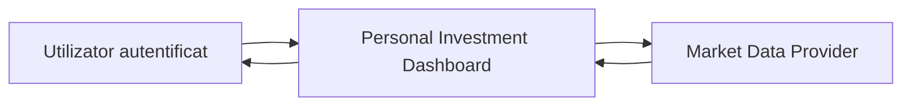

### 1.2. Container

Web Application gestioneaza interfata, Dashboard Application cererile, Market Data Store preturile, User Data Store datele private, iar Market Data Collector actualizeaza preturile periodic.

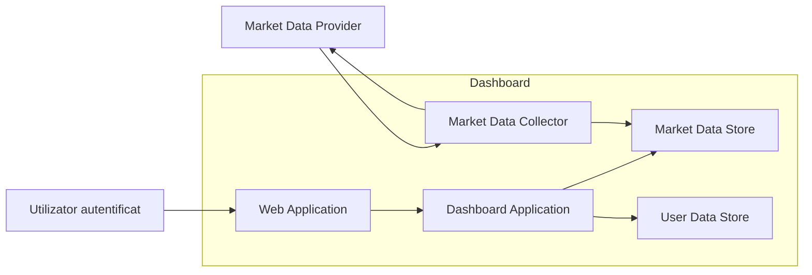

### 1.3. Component

Descompune Dashboard Application in IdentityService, StockCatalogService, StockPriceService, PriceHistoryService si WatchlistService.

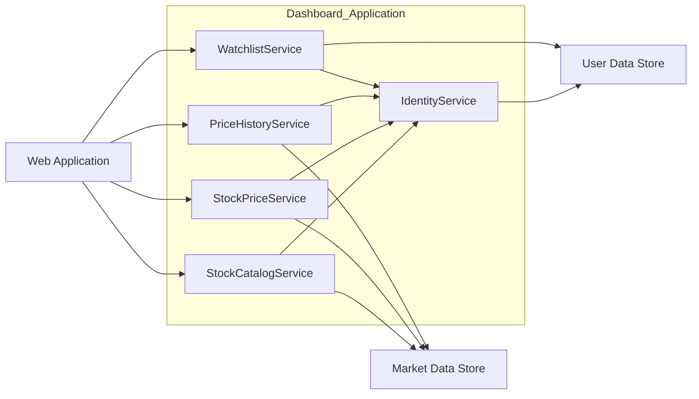

### 1.4. Secventa A - Sincronizare si publicare

Collectorul preia periodic observatii de la furnizor, valideaza datele si le salveaza atomic. Sunt tratate date invalide, erori de stocare si rate limit.

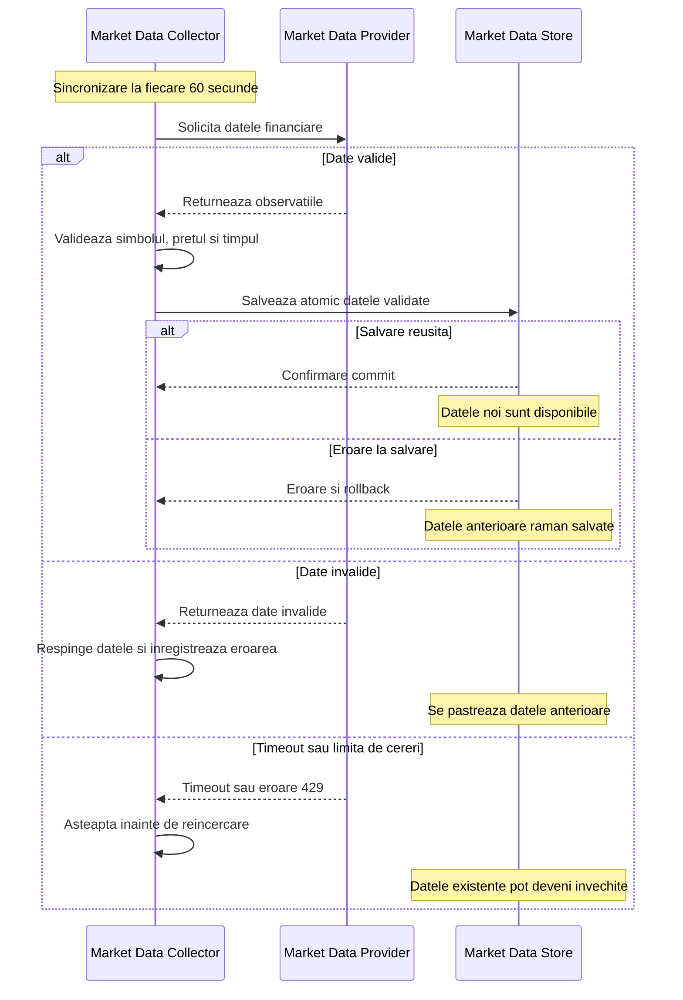

### 1.5. Secventa B - Citire si cautare

Utilizatorul cere pretul unui simbol. Serviciul verifica sesiunea si simbolul, apoi citeste doar din Market Data Store; datele vechi nu sunt prezentate drept actuale.

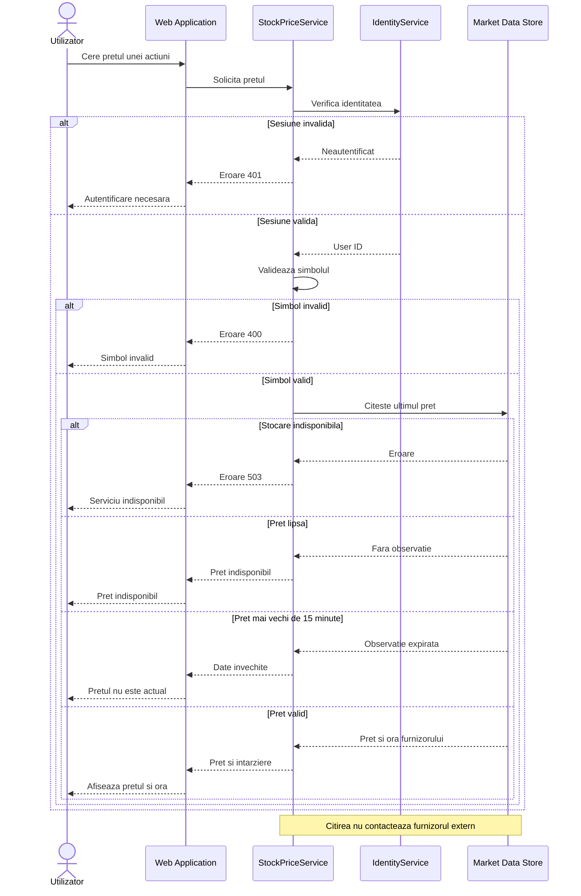

### 1.6. Secventa C - Modificare privata

Utilizatorul modifica watchlist-ul propriu. Sunt verificate sesiunea, datele si proprietarul; succesul este comunicat numai dupa commit.

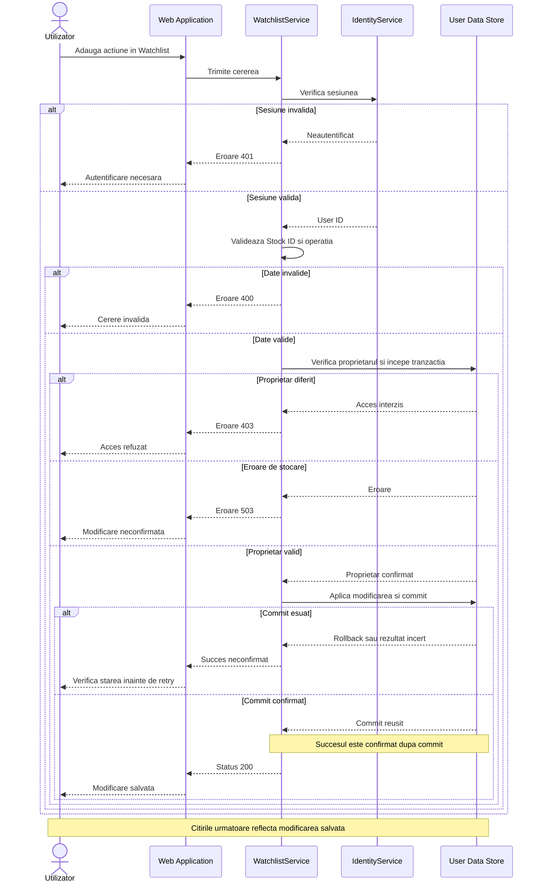

---

## 2. Student Skill Exchange

**Statut:** Proiect alternativ, supus acceptarii profesorului.  
**Tinta de capacitate din Laboratorul 2:** 5.016 RPS la varf, pentru 30.000 de utilizatori simultani (estimare de proiectare).

**Decizie arhitecturala:** Profilurile canonice sunt separate de indexul de cautare. Operatiile private sunt autorizate si confirmate numai dupa commit.

### 2.1. System Context

Studentul si moderatorul interactioneaza cu Student Skill Exchange.

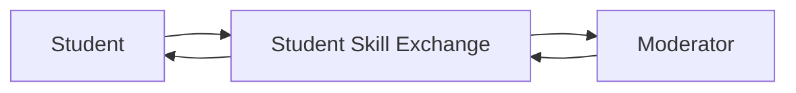

### 2.2. Container

Web Application trimite cererile catre Skill Exchange Application. Datele sunt salvate in Exchange Data Store, iar Search Index Worker actualizeaza asincron Skill Search Index.

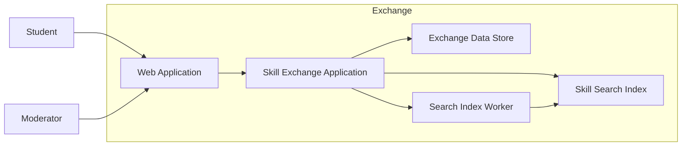

### 2.3. Component

Skill Exchange Application contine IdentityService, StudentProfileService, SkillSearchService, ExchangeRequestService si ModerationService.

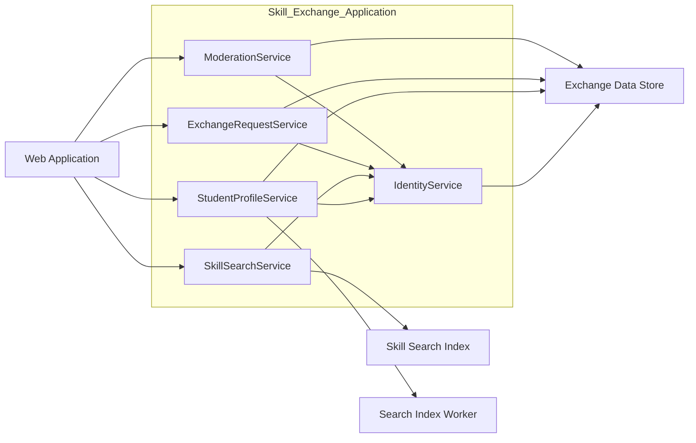

### 2.4. Secventa A - Sincronizare si publicare

Actualizarea profilului se salveaza atomic impreuna cu evenimentul pentru indexare. Indexarea ulterioara poate intarzia si poate fi reincercata.

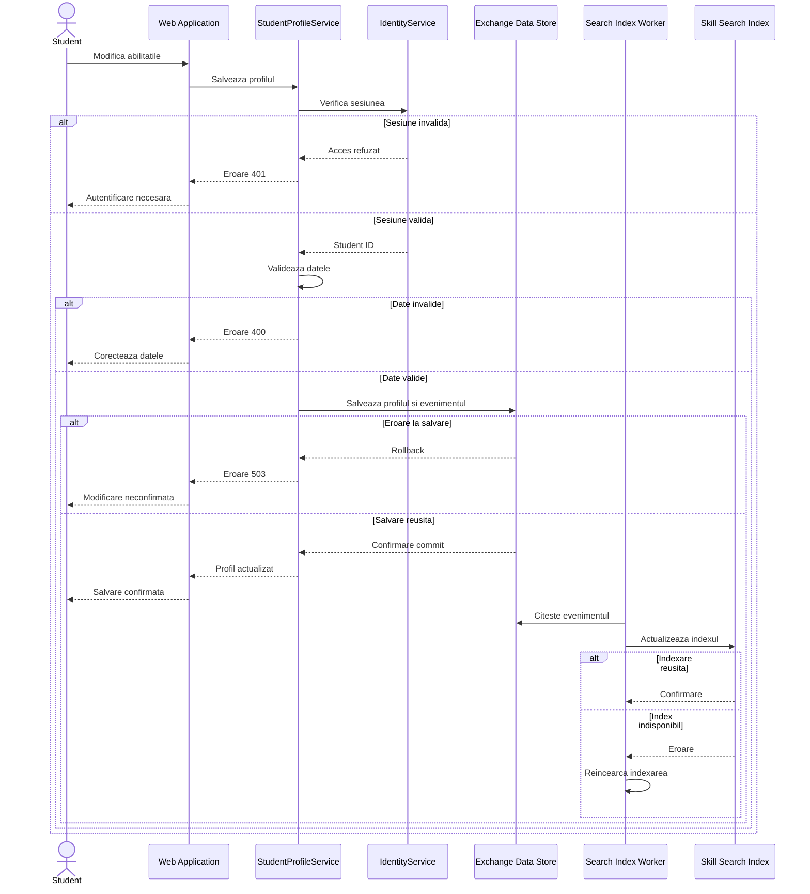

### 2.5. Secventa B - Citire si cautare

Studentul cauta parteneri folosind filtre validate. Sistemul verifica autentificarea, disponibilitatea indexului si accesul la profiluri.

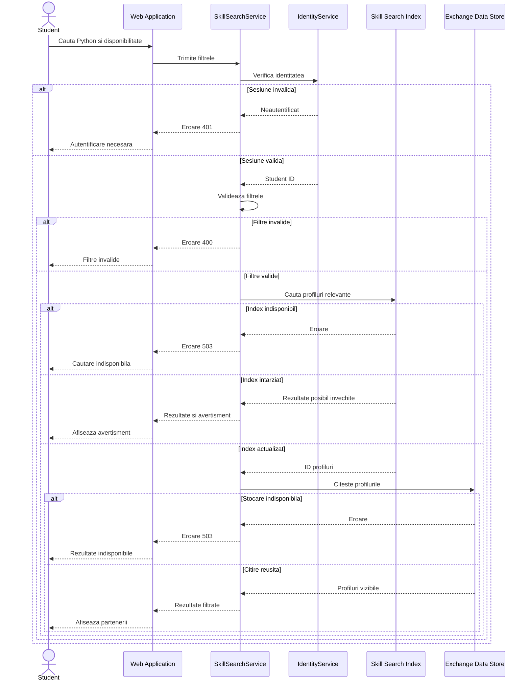

### 2.6. Secventa C - Modificare privata

Acceptarea unei cereri necesita sesiune valida, destinatar corect si stare pending. Succesul este confirmat numai dupa commit.

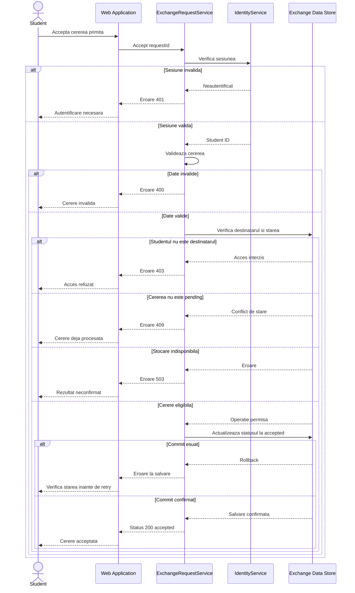

---

## Concluzie

Ambele proiecte separa responsabilitatile intre interfata, logica de aplicatie si stocare. Diagramele de secventa descriu atat traseele reusite, cat si validarea intrarilor, autorizarea si comportamentul in caz de eroare.
